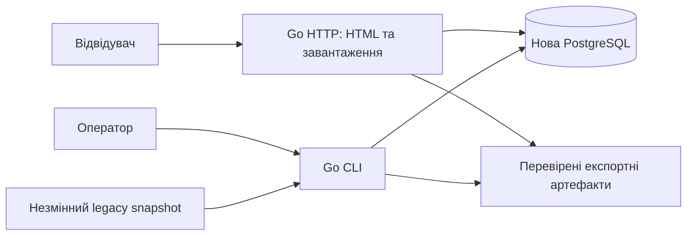

# Architecture

Мова Go та функціональний обсяг підтверджені; наведені технічні рішення —
базова пропозиція для реалізації, яку можна змінити з обґрунтуванням.
Детальні контракти — у [HLD](HLD.md), критерії — у [requirements](REQUIREMENTS.md).

## Контекст і межі

Старий runtime і його БД не є залежностями обслуговування нового сайту.
Перемикання домену/проксі — окрема операція після репетиції міграції.
Імпорт приймає контрольовані локальні файли; HTTP не приймає довільні URL чи uploads.

## Рішення

| ID | Рішення | Причина й компроміс |
|---|---|---|
| ADR-01 | Модульний Go-моноліт: HTTP і CLI зі спільними application/domain пакетами. | Одна модель правил, проста експлуатація; міграція запускається окремим процесом і не займає HTTP workers. |
| ADR-02 | PostgreSQL як цільова БД з новою схемою й версійними міграціями. | Транзакційна публікація, індекси й потокове завантаження великого корпусу; потребує окремої БД. Не переносити таблицю на кожну мову. Остаточну місткість підтвердити вимірюванням. |
| ADR-03 | Серверний HTML через `html/template`, CSS, мінімальний необов'язковий JS. | Пошук доступний без JS; окремий SPA не потрібен для підтверджених сценаріїв. |
| ADR-04 | Незмінні dataset versions, staging і атомарний active pointer. | Не показує частковий імпорт, спрощує rollback; потребує місця для кількох наборів і політики retention після запуску. |
| ADR-05 | Raw texts зберігаються, нормалізований ключ — похідний і версійний. | Пошук без регістру не руйнує апострофи, варіанти письма та оригінальні значення. |
| ADR-06 | Експорти готуються до публікації й адресуються через маніфест. | Вебзапит не генерує великий файл; артефакт публікується тільки після завершення та перевірки hash. |
| ADR-07 | Спочатку точний пошук і контрольовані маски; без Elasticsearch/vector/LLM. | Саме це потрібно для підтверджених use cases. Додаткові індекси — після вимірювань, без зміни контракту результату. |
| ADR-08 | Операторські зміни через CLI з окремими правами; вебсервіс читає словник. | Відсутня потреба в admin UI й користувацьких облікових записах першої версії. |

## Межі модулів

- **Catalog** знає локалі, доступні напрямки та версію набору.
- **Lookup** визначає нормалізацію, режими, порядок, cursor і обмеження.
- **Presentation** відображає дані, локалізує UI й адаптує підтримувані старі URL.
- **Import** парсить legacy-формати й зберігає provenance; не змінює семантику Lookup.
- **Publication** перевіряє набір, перемикає active pointer, керує експортами й відкатом.
- **Operations** забезпечує конфігурацію, diagnostics і перевірку restore.

Домен не залежить від HTTP, legacy-таблиць чи файлових шляхів. Не вводити
універсальну систему плагінів або складний repository framework без потреби.

## Межі довіри й експлуатація

Публічний ввід проходить перевірку до запиту в БД; SQL параметризований,
HTML екранований. Назва таблиці не утворюється з коду локалі. HTTP має окремий
обліковий запис БД з читанням опублікованих наборів; CLI має запис лише в новій БД.
Облікові дані не записуються в Git, маніфести чи логи. TLS завершується на
налаштованому reverse proxy або в сервісі відповідно до майбутнього deployment.

Пошук має timeout і ліміт сторінки; широкий wildcard може бути відхилений
як надто дорогий. Зовнішні кеші, репліки й partitioning не є початковою вимогою.
Точні версії Go/PostgreSQL, ресурсні бюджети, RPO/RTO та deployment задаються
перед відповідним інтеграційним етапом, а не видаються за виміряні зараз.
