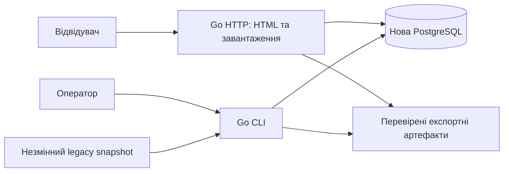

# Document: ARCHITECTURE.md

# Architecture

Мова Go та функціональний обсяг підтверджені; наведені технічні рішення —
базова пропозиція для реалізації, яку можна змінити з обґрунтуванням.
Детальні контракти — у [HLD](HLD.md), критерії — у [requirements](REQUIREMENTS.md).

## Контекст і межі



Старий runtime і його БД не є залежностями обслуговування нового сайту.
Перемикання домену/проксі — окрема операція після репетиції міграції.
Імпорт приймає контрольовані локальні файли; HTTP не приймає довільні URL чи uploads.

## Рішення

| ID | Рішення | Причина й компроміс |
|---|---|---|
| ADR-01 | Модульний Go-моноліт: HTTP і CLI зі спільними application/domain пакетами. | Одна модель правил, проста експлуатація; міграція запускається окремим процесом і не займає HTTP workers. |
| ADR-02 | PostgreSQL як цільова БД з новою схемою й версійними міграціями. | Транзакційна публікація, індекси й потокове завантаження великого корпусу; потребує окремої БД. Не переносити таблицю на кожну мову. Остаточну місткість підтвердити вимірюванням. |
| ADR-03 | Серверний HTML через `html/template`, CSS, мінімальний необов'язковий JS. | Пошук доступний без JS; окремий SPA не потрібен для підтверджених сценаріїв. |
| ADR-04 | Незмінні dataset versions, staging і атомарний active pointer. | Не показує частковий імпорт, спрощує rollback; потребує місця для кількох наборів і політики retention після запуску. |
| ADR-05 | Raw texts зберігаються, нормалізований ключ — похідний і версійний. | Пошук без регістру не руйнує апострофи, варіанти письма та оригінальні значення. |
| ADR-06 | Експорти готуються до публікації й адресуються через маніфест. | Вебзапит не генерує великий файл; артефакт публікується тільки після завершення та перевірки hash. |
| ADR-07 | Спочатку точний пошук і контрольовані маски; без Elasticsearch/vector/LLM. | Саме це потрібно для підтверджених use cases. Додаткові індекси — після вимірювань, без зміни контракту результату. |
| ADR-08 | Операторські зміни через CLI з окремими правами; вебсервіс читає словник. | Відсутня потреба в admin UI й користувацьких облікових записах першої версії. |

## Межі модулів

- **Catalog** знає локалі, доступні напрямки та версію набору.
- **Lookup** визначає нормалізацію, режими, порядок, cursor і обмеження.
- **Presentation** відображає дані, локалізує UI й адаптує підтримувані старі URL.
- **Import** парсить legacy-формати й зберігає provenance; не змінює семантику Lookup.
- **Publication** перевіряє набір, перемикає active pointer, керує експортами й відкатом.
- **Operations** забезпечує конфігурацію, diagnostics і перевірку restore.

Домен не залежить від HTTP, legacy-таблиць чи файлових шляхів. Не вводити
універсальну систему плагінів або складний repository framework без потреби.

## Межі довіри й експлуатація

Публічний ввід проходить перевірку до запиту в БД; SQL параметризований,
HTML екранований. Назва таблиці не утворюється з коду локалі. HTTP має окремий
обліковий запис БД з читанням опублікованих наборів; CLI має запис лише в новій БД.
Облікові дані не записуються в Git, маніфести чи логи. TLS завершується на
налаштованому reverse proxy або в сервісі відповідно до майбутнього deployment.

Пошук має timeout і ліміт сторінки; широкий wildcard може бути відхилений
як надто дорогий. Зовнішні кеші, репліки й partitioning не є початковою вимогою.
Точні версії Go/PostgreSQL, ресурсні бюджети, RPO/RTO та deployment задаються
перед відповідним інтеграційним етапом, а не видаються за виміряні зараз.


# Document: HLD.md

# High-Level Design

Це цільова будова нового застосунку; перелічених пакетів і команд ще немає.
Нормативна поведінка — у [REQUIREMENTS](REQUIREMENTS.md).

## Компоненти та майбутня структура

```text
cmd/slovnyk/               # serve та операторські subcommands
internal/catalog/         # локалі, напрямки, dataset metadata
internal/lookup/          # запит, нормалізація, результати, cursor
internal/importer/        # inventory, parsers, staging, reconciliation
internal/publication/     # verify, publish, rollback, export
internal/storage/postgres/
internal/httpui/          # handlers, locale fallback, legacy adapter
internal/ops/             # config, health, diagnostics
migrations/               # лише нова схема, версійні SQL
web/templates/            # html/template
web/static/
web/locales/              # перевірені ресурси UI
testdata/                 # синтетичні fixtures, без повного корпусу
docs/
```

Go HTTP і CLI використовують ті самі application services. В HTTP немає
операторських routes. Команди нижче — запропонований інтерфейс, не готові інструкції запуску:

```text
slovnyk serve
slovnyk import inspect --source <directory> --report <path>
slovnyk import run --manifest <path>
slovnyk dataset verify <id>
slovnyk dataset export <id>
slovnyk dataset publish <id>
slovnyk dataset rollback <previous-id>
```

<a id="fun-catalog"></a>

## FUN-CATALOG — довідник і версії

Модель зберігання (логічна; DDL створюється при реалізації):

| Сутність | Ключові поля та правила |
|---|---|
| `datasets` | ID, manifest hash, parser/mapping/normalization versions, state, timestamps; незмінна після ready |
| `active_dataset` | Один рядок з dataset ID; зміна транзакційна, publish серіалізується блокуванням |
| `dataset_locales` | `(dataset_id, code)`, назва; сирі legacy-коди зберігаються, aliases окремо |
| `dataset_pairs` | `(dataset_id, source_locale, target_locale)`, число унікальних зв'язків, export reference |
| `translations` | ID, dataset ID, source/target locale, source/target text, source search key |
| `source_files` | Dataset, artifact hash, relative name, format, bytes, logical record counts, validation state |
| `translation_origins` | Translation ID, source file/record locator, чотири сирі поля до mapping, nullable legacy count/status; усі входження дублікатів |
| `import_runs` | Dataset, run identity, state, batch checkpoints, totals, failure reason |
| `import_issues` | File, locator, issue code, безпечний опис; raw record в окремому контрольованому quarantine за потреби |
| `legacy_query_snapshots` | Доступні поля `queries`, raw timestamp без timezone, походження; не нова live-аналітика |
| `exports` | Dataset/pair, artifact path, content hash, compressed bytes, logical record count |

Логічна унікальність перекладу: dataset + чотири **оригінальні** значення.
Не покладатися на B-tree всього довгого текстового кортежу: при реалізації
використати bounded digest key з перевіркою рівності оригіналів; hash collision
має зупинити verify з явною помилкою, а не злити різні записи.
Нормалізований ключ не унікальний. Ідентичні ключі не об'єднують написання.
Усі посилання обмежені одним dataset; FK та verify перевіряють цілісність.

<a id="fun-lookup"></a>

## FUN-LOOKUP — пошук

HTTP-контракт пропозиції: `GET /search?from=uk-ua&to=en-us&q=...&mode=exact&ui=uk&cursor=...`.
`mode` — `exact` або `mask`. `GET /` показує форму; `GET /languages` — каталог.
HTML — основний інтерфейс; публічний JSON API поки не обіцяється.

1. Перевірити розмір, UTF-8, локалі, mode і cursor. Початкові конфігуровані
   defaults: 1024 Unicode code points запиту, 8 KiB query text, 50 зв'язків
   на сторінку, максимум 100; DB timeout 2 s. Це захисні defaults, не SLO.
2. Зафіксувати dataset ID на перший запит. Обрізати крайні пробіли запиту,
   застосувати NFC → Unicode case folding → NFC; так само будувати ключ з
   source text, але без обрізання/очищення raw values. Версію бібліотеки та
   Unicode-даних фіксувати у normalization version.
3. Exact використовує рівність ключа. У mask `*` компілюється в `%`, `?` у `_`,
   буквальні `%`, `_` та escape-символ екрануються для SQL LIKE з явним ESCAPE.
   Довільні regular expressions і SQL від клієнта не приймаються.
4. Сортування за `(source_key, source_text, target_text, id)` з визначеною
   bytewise/C collation. LIMIT+1 встановлює `has_more`. Групування source text
   виконується лише в межах сторінки; велика група може продовжуватися на наступній.
5. Cursor містить dataset, fingerprint параметрів і останній sort tuple;
   перевіряється цілісність і межі. Неправильний cursor → 400, недоступна стара
   версія → 410 з пропозицією повторити пошук. Dataset не змінюється між сторінками.

Індексний початковий план: dataset + pair + source key; перевірити довгі
значення й обмеження індексних ключів на реальному corpus. Для exact можливий
digest нормалізованого ключа + residual equality. Для mask — виміряти prefix
та infix плани; не обіцяти швидкий `%...%` без вимірювань. Усі режими під timeout.
Timeout → явна помилка обмеження (503), а не «нічого не знайдено».
Новий збір `queries` у цей потік не входить.

<a id="fun-ui"></a>

## FUN-UI — інтерфейс і сумісність

Каталоги локалей словника відокремлені від UI-кодів. Явний підтримуваний `ui`
має пріоритет над `Accept-Language`; потім configured default. Якщо alias
мовного коду неоднозначний, не вибирати варіант мовчки. Пропозиція стартового
UI — українська й англійська; повний перелік після OQ-06.

Legacy adapter знає лише явний allowlist handlers і параметрів. `sel`/`pre`
автоматично обирають mask, якщо `iw` містить `*`/`?`, як старий пошук; нова форма
має явний mode. Для `pre` — UTF-8 `text/plain` з тим самим обмеженим результатом
і позначенням продовження. `hom`/`dwn`/`loc` можна зіставити новим сторінкам;
`top` показує повідомлення про недоступність статистики, доки її не реалізовано.
Точний старий path, redirects і sitemap — після інвентаризації OQ-04.

<a id="fun-import"></a>

## FUN-IMPORT — інвентаризація та завантаження

Два окремі adapters: legacy CSV4.gz і описаний DB snapshot export. П'ятипольний
CSV отримує власний format ID лише після аудиту: його не вгадувати по одному рядку.
CSV читається `encoding/csv`, gzip перевіряється до EOF; рядок текстового файла
не дорівнює CSV-запису з quoted newline. Правила порожніх полів, BOM і додаткових
колонок явні: порожні мови/тексти, хибний UTF-8 та неочікувані колонки → issue;
BOM допускається лише на початку файла й враховується у parser version.

Source manifest перелічує очікувані файли з SHA-256, parser/mapping versions,
обраним джерелом істини, очікуваними локалями, відомими пропусками й exceptions.
Шлях не визначає ідентичність запису сам по собі. Fingerprint імпорту складається
з канонічного маніфесту вмісту й versions; зміна байтів або правил — новий dataset.
Aliases застосовуються лише явним mapping зі збереженням оригінальних полів.

Import state: `created → loading → validating → ready`; помилка → `failed`.
Активність — окремий pointer, не додатковий mutable стан рядків перекладів.
Batch і checkpoint комітяться разом, імпорт одного fingerprint захищений lock.
Для gzip без надійного seek повтор може читати від початку; committed records
ідентифікуються за source artifact + logical record index і не дублюються.
Файли поза маніфестом не потрапляють у імпорт мовчки.

<a id="fun-publish"></a>

## FUN-PUBLISH — звіряння, експорт і публікація

Verify перевіряє облік записів/файлів, сирі значення, provenance, локалі, дублікати,
детерміновані per-pair digests від відсортованих length-prefixed UTF-8 кортежів,
а також контрольні exact/mask queries. Самі counts не доводять рівність даних.
Якщо CSV recovery ненадійний або не завершено gzip, файл failed; його totals
не видаються за повний облік записів. Рішення щодо кожної втрати зафіксоване.

До ready формуються та перевіряються експорти через temp file → завершення →
hash → atomic rename на одному filesystem. Публікація перевіряє наявність
артефактів і validation report, бере DB lock та змінює active pointer одним commit.
Артефакт без commit може бути orphan і прибирається лише окремим maintenance;
активний набір ніколи не посилається на незавершений файл.
Старі версії зберігаються для cursor і rollback за майбутньою retention policy.

<a id="fun-export"></a>

## FUN-EXPORT — завантаження

`GET /downloads` показує manifest активного набору; файл видається за непрозорим
ID, не за довільним path. `Content-Disposition: attachment`, тип gzip; SHA-256
та logical record count доступні поруч. Export CSV4 є сумісним обміном перекладів,
а не повним backup метаданих. Відсутня пара → 404. Публічний доступ до artifacts
включається після OQ-05; до цього тести — на синтетичних fixtures.

<a id="fun-ops"></a>

## FUN-OPS — експлуатація і відновлення

`GET /healthz` — живий процес; `/readyz` — підключення до БД, сумісна schema
і готовий активний dataset, 503 за неготовності. DSN і secrets передаються
через runtime config, не через старі Perl-конфіги. CLI відрізняє exit 0 успіх,
ненульовий результат перевірки й execution error; звіт містить їх явно.

Backup складається з консистентного snapshot нової БД і всіх artifacts,
на які він посилається, плюс manifests/config versions. До завершення backup
GC заборонений; restore перевіряє всі references і hashes. Старий сайт не
вимикається і старі snapshots не видаляються автоматично. Деталі репетиції,
перемикання та відкату — у [MIGRATION](MIGRATION.md).


# Document: INDEX.md

# Slovnyk: джерело істини

Дата базового дослідження: 2026-10-21. Новий проєкт: `~/wrk/projects/slovnyk/slovnyk/`;
старий: `~/wrk/projects/slovnyk/slovnyk1.0/`.

## Статус і правила

**Підтверджено користувачем:** новий проєкт з нуля, мова Go, можливість пізніше
перенести дані зі старого; основа першого релізу — пошук, маски, вибір мов,
локалізація й завантаження словників; нова статистика запитів — окремий етап.
Решта цільових рішень нижче — запропонований базовий
контракт за результатами дослідження, а не твердження про вже погоджені побажання.
Реалізації, повного аудиту вмісту архівів та пробної міграції ще немає.

Прямі рішення користувача мають пріоритет. Поведінку визначають requirements,
сценарії пояснюють її, architecture визначає межі й рішення, HLD — компоненти та
контракти. Виявлену суперечність виправляти разом у пов'язаних документах;
реалізація не повинна непомітно змінювати вимоги. Зміни фіксувати у Git.

## Документи

| Документ | Призначення |
|---|---|
| [LEGACY.md](LEGACY.md) | Перевірені факти, джерела, обмеження дослідження |
| [USE_CASES.md](USE_CASES.md) | Актори, сценарії, альтернативи й помилки |
| [REQUIREMENTS.md](REQUIREMENTS.md) | Нормативна поведінка й критерії приймання |
| [ARCHITECTURE.md](ARCHITECTURE.md) | Межі системи, рішення, компроміси |
| [HLD.md](HLD.md) | Компоненти, модель даних, потоки та інтерфейси |
| [MIGRATION.md](MIGRATION.md) | Облік даних, перевірка, перемикання й відкат |
| [TRACEABILITY.md](TRACEABILITY.md) | Вимога → сценарій → компонент → перевірка |

## Пропоновані етапи

1. **M0 — контракт:** уточнити відкриті питання; зберегти фактичну базу старої системи.
2. **M1 — вертикальний зріз:** Go-сервіс, нова схема, імпорт синтетичного набору,
   точний пошук і маски, браузерна форма, тести та health/readiness.
3. **M2 — репетиція міграції:** повний аудит джерел, повторюваний staged-імпорт,
   звіряння, експорт, локалізація та адаптер старих посилань.
4. **M3 — запуск:** перевірка на реальному корпусі, backup/restore, узгоджене
   перемикання трафіку й перевірений відкат. Старі дані не видаляти.

Статистика популярності — окремий наступний етап після рішення про її семантику.
Наявні історичні дані статистики зберігати незалежно від цього рішення.

## Відкриті питання

| ID | Питання | Що блокує |
|---|---|---|
| OQ-01 — вирішено | Основа першого релізу — функції старого сайту без нової статистики; користувач підтвердив 2026-10-21. | Не блокує |
| OQ-02 | Є актуальний dump/доступ лише для читання до старої PostgreSQL, чи тільки CSV? Що є повним авторитетним набором? | Обіцянку повноти міграції та перенесення `count/status/queries` |
| OQ-03 | Де працюватиме сайт, який трафік і допустимі ресурси/затримки? | Числові SLO, остаточний профіль розгортання |
| OQ-04 | Які домени, rewrite-правила та старі URL треба підтримати? | Гарантію сумісності зовнішніх посилань |
| OQ-05 | Яка ліцензія і походження самих словникових даних? | Публічне розповсюдження корпусу й завантажень |
| OQ-06 | Які UI-мови потрібні на запуску? Пропозиція: українська й англійська. | Остаточний перелік перевірених перекладів UI |

OQ-02/04/05 блокують відповідні частини запуску, але не створення Go-каркаса
та роботу на синтетичних fixtures. Не підміняти відповіді припущеннями.


# Document: LEGACY.md

# Перевірена база старого Slovnyk

Досліджено локальні файли `../slovnyk1.0/` 2026-10-21, Git HEAD
`94640dc6fe2fde643af3ee746254e0d60990a0ce`.
Це огляд вихідного коду та метаданих файлів, не перевірка робочого production.

## Факти та джерела

Усі шляхи в цій таблиці відносні до старого проєкту.

| Джерело | Що встановлено |
|---|---|
| `README.md`, `cgi/dic.fcgi` | Perl/FastCGI, залежність від Wono; багатомовний словник |
| `cgi/dic.fcgi:315–393`, `cgi/share/templates/sel.html` | Вибір мов джерела, перекладу, UI; точний пошук; `*` = послідовність, `?` = один символ; групування перекладів |
| `cgi/dic.fcgi:396–400`, `pre.html` | Текстове представлення результатів через `hn=pre` |
| `cgi/dic.fcgi:403–558` | Сторінки локалізацій, CSV-завантажень і популярних запитів |
| `sql/slovnyk.sql:54–72`, `:383–391` | `locales`, `queries`, 32 таблиці перекладів за мовою джерела; ключ `(out_lang, inp_word, out_word)`; поля `count`, `status` |
| `sql/slovnyk.sql:397–414`, `cgi/dic.fcgi:378` | Статистика рахує знайдені вихідні слова, зокрема результати маски; це не просто кількість HTTP-запитів |
| `utils/csv2pg`, `utils/etc/csv2pg.conf:32` | Імпортер очікує п'ять CSV-полів, переносить п'яте в `count`, встановлює `status=1`; має alias `sr-sp → sr-rs` |
| `utils/csv2split:82–112` | Генерація завантажень із чотирма полями, без ваги й статусу |
| `utils/xrf2csv:117–132` | На етапі генерації п'ятипольного CSV обиралися переклади з максимальною вагою; доступний експорт може бути похідним набором |
| `data/loc/*.po`, `data/*.ods`, `data/sitemap/` | Ресурси локалізації, довідники, sitemap; вони не доводять повноту corpus або готовність усіх перекладів |

## Інвентаризація доступних завантажень

- `csv/`: **992** файли `*.csv.gz`, разом **535 766 648 байтів** стиснених даних.
- У назвах присутні 32 коди джерела й 32 коди призначення.
- Є `sr-rs → sr-rs`; серед усіх різномовних комбінацій відсутній файл
  `en-gb → fr-fr`. Не створювати відсутню пару автоматично.
- Перевірено лише перші п'ять логічних CSV-записів у кожному з трьох файлів:
  `slovnyk_uk-ua_en-us.csv.gz`, `slovnyk_en-us_uk-ua.csv.gz`,
  `slovnyk_sr-rs_sr-rs.csv.gz`. Вони декодуються як UTF-8 і містять чотири поля.
  Це **не** доказ однакового формату решти файлів чи справності повного gzip.
- Вибірка включає власні назви, лапки, апострофи, багатослівні назви й варіанти
  письма. Модель «одне слово з літер» втратила б дані.

## Розбіжності й невідоме

Пошукові SQL у `cgi/etc/cfg/dic.conf:51–52` використовують `inp_lwrd`, якого
немає у збереженому DDL. Робоча схема могла відрізнятися. DDL також містить
`DROP SCHEMA ... CASCADE`: не запускати його як міграцію нового проєкту.

Повного підрахунку записів, перевірки gzip/UTF-8, дублікатів, ліцензій,
збігу пар усередині CSV з назвами файлів і порівняння з живою БД не виконано.
Доступ до БД не перевірявся; наявність конфігурації не означає доступність БД.
Секрети й старі абсолютні шляхи конфігурації не переносити.

Apache 2.0 зазначена в README старого коду; це окремо не встановлює ліцензії
словникових даних. Рекламні вставки й аналітика старого UI не є вимогами нового.


# Document: MIGRATION.md

# План міграції даних

Це план майбутньої операції. Жодної міграції чи зміни старих файлів не виконано.
Підстава — [LEGACY](LEGACY.md); технічні компоненти — [HLD](HLD.md).

## 1. Вибрати авторитетне джерело

- Інвентаризувати доступні CSV, dump/live schema, резервні копії, PO й URL.
- Для БД отримати узгоджений snapshot через read-only export; перевірити
  фактичні поля, індекси, кодування та статистику. Не запускати старий DDL.
- Узгодити, що переносимо: snapshot БД або наявну CSV-колекцію. Не змішувати
  мовчки CSV і БД різних дат: кожне джерело має походження й precedence policy.
- Якщо є тільки CSV4, гарантія — збереження доступних перекладних зв'язків,
  **не** всього історичного вмісту БД. `count/status/queries` відсутні.

Результат: source manifest з hashes, форматами, датою snapshot (або unknown),
правами на дані, відомими прогалинами й погодженим scope. Старі файли readonly.

## 2. Повний аудит

Перевірити кожен gzip до EOF, декодування, кожен логічний CSV-запис і кількість
полів. Порахувати напрямки, розміри/довжини, дублікати, Unicode-колізії,
невідомі коди, порожні значення, відмінності вмісту від назв файлів.
Результат повинен пояснити всі 992 наявні архіви, але не припускати, що це
назавжди правильна кількість чи повна матриця мов.

`sr-rs → sr-rs` не відкидати. Відсутній `en-gb → fr-fr` не відновлювати
штучно. Старий alias `sr-sp → sr-rs` не застосовувати до всіх джерел без
перевірки та версійного mapping. Зберігати вихідні локалі й тексти.

## 3. Репетиція у новій БД

Створити нову схему; виконати dry-run та import у staging. Звірити повні
per-pair digests і totals, exact/mask queries, punctuation/Unicode fixtures,
CSV export round-trip. Перевірити fault injection: обрив gzip, DB disconnect,
зупинка після batch, повтор імпорту й конкурентний publish.

Для файлів, які коректно розібрані повністю:

```text
parsed logical records = accepted unique + duplicate occurrences + rejected
manifest files = completed files + explicitly failed/excluded files
```

Для failed CSV без визначених меж записів повний parsed count невідомий;
такий файл не може виглядати успішно врахованим. Дублікати не збільшують
число унікальних зв'язків, але зберігають усі origins і legacy metadata.
Conflicting metadata не усереднювати й не обирати випадково.

Будь-яка втрата має reason, locator і явне рішення. Без unresolved errors
або з документованими погодженими exceptions dataset може пройти verify.
Зберегти результати, витрати часу/RAM/диска та query latencies; числовий
capacity gate погодити до production, коли відомі ресурси й трафік.

## 4. Перемикання

1. Перевірити license/scope, підтримувані старі URL, UI-мови й приймальні тести.
2. Підготувати backup нової БД + artifacts і **перевірити restore** окремо.
3. Якщо старі словникові дані змінюються, погодити freeze і фінальний snapshot;
   непомітного dual-write або неперевіреного delta sync немає.
4. Імпортувати фінальний snapshot, verify, exports, atomic publish.
5. Перемкнути proxy/domain окремою операторською дією. Виконати smoke tests:
   пошук, маска, UI locale, legacy link, download, readiness.
6. Зберегти попередній endpoint, конфігурацію й snapshots до завершення
   узгодженого періоду спостереження. Пороги помилок/затримок — до cutover.

## 5. Відкат

За проблем із новим dataset перемкнути active pointer на попередній перевірений;
за проблем із застосунком/сумісністю повернути трафік старому сайту.
У першому релізі новий сайт не приймає редагування словника й не збирає нову
статистику, тому зворотного перенесення користувацьких змін не потрібно.
Якщо цей scope зміниться, план відкату переглядається до запуску запису.

Відкат не видаляє failed/new dataset або звіти автоматично. Після restore
перевіряються active version, hashes, counts, provenance й контрольні запити.
Факт завершення міграції засвідчує звіт репетиції та фінальної операції,
а не лише успішний exit code імпортера.


# Document: REQUIREMENTS.md

# Requirements

Статус: запропонований базовий контракт; підтверджений користувачем обсяг і
відкриті питання — у [INDEX](INDEX.md). Усі acceptance tests поки **заплановані**.

## Межі

Перша реалізація — словниковий вебсайт на Go і CLI оператора. Зберігаємо
напрямлені зв'язки між текстами в локалях, включно з фразами та власними назвами.
Автоматичний переклад, LLM, облікові записи, публічне редагування, модерація,
морфологічний/семантичний пошук та новий збір популярності не входять у базову версію.
Зворотний переклад і транзитивні зв'язки не генеруються без окремої вимоги.

Префікс `REQ-` в ID позначає вимогу, наприклад FR-01 у таблиці трасування. Стрілка в рядку
пов’язує вимогу з її основним компонентом HLD; додаткові компоненти — у
[TRACEABILITY](TRACEABILITY.md).

## Функціональні вимоги

| ID | Контракт | Критерій приймання |
|---|---|---|
| [REQ-FR-01] | Довідник зберігає всі імпортовані коди локалей; наявність локалі, UI-перекладу і напрямку — різні ознаки. | AT-01: `en-gb` і `en-us` окремі; `eo-xx`/`la-va` не відкидаються через сучасну валідацію тегів; відсутня пара показана явно.  -> [FUN-CATALOG](HLD.md#fun-catalog) |
| [REQ-FR-02] | Точний пошук використовує ключ NFC + Unicode case folding; оригінальний текст незмінний. Запит обрізає лише крайні пробіли. Діакритика, пунктуація і внутрішні пробіли значущі. | AT-02: регістр і канонічно еквівалентний Unicode збігаються; апострофи/лапки зберігаються; різні оригінали з одним ключем повертаються всі.  -> [FUN-LOOKUP](HLD.md#fun-lookup) |
| [REQ-FR-03] | Режим маски явний: тільки `*` і `?` спеціальні; решта символів буквальні. Семантика застосовується до нормалізованого ключа. | AT-03: `*`, `?`, `%`, `_`, `\\`, кирилиця й combining marks перевірені; точний режим шукає буквальні `*`/`?`; SQL-метасимволи не розширюють маску.  -> [FUN-LOOKUP](HLD.md#fun-lookup) |
| [REQ-FR-04] | Пошук обмежений і має стабільну пагінацію на одній версії набору; однакова локаль джерела й призначення допустима за наявності даних. | AT-04: кілька сторінок без пропусків/повторів; незавершена видача має cursor; `sr-rs → sr-rs` доступний; зміна версії не змішує сторінки.  -> [FUN-LOOKUP](HLD.md#fun-lookup) |
| [REQ-FR-05] | Вебформа працює без JavaScript, має зрозумілі помилки, порожній результат і незалежну UI-мову з fallback. | AT-05: пошук у браузері без JS; unknown locale, no match і unavailable pair розрізняються; відсутній UI-ключ має fallback.  -> [FUN-UI](HLD.md#fun-ui) |
| [REQ-FR-06] | Експорт наявної пари — UTF-8 CSV.gz з чотирма полями, без заголовка, з версією, кількістю логічних записів і SHA-256 файлу. | AT-06: декомпресія та CSV-парсинг відтворюють точну множину напрямлених зв'язків версії, включно з лапками й переносами рядків.  -> [FUN-EXPORT](HLD.md#fun-export) |
| [REQ-FR-07] | Інвентаризація та dry-run не змінюють джерело чи активні дані; кожен вхідний файл має hash, розмір, формат і результат перевірки. | AT-07: пошкоджений gzip, хибний UTF-8, невідомий формат і невідповідність локалей назві файла позначені; active dataset незмінний.  -> [FUN-IMPORT](HLD.md#fun-import) |
| [REQ-FR-08] | Імпорт потоковий, повторюваний і виконується у staging. Ідентичний snapshot з тим самим parser/mapping не створює дубліката опублікованого набору. | AT-08: збій після batch і повтор дають той самий результат, що чистий запуск; жодних часткових наборів у пошуку.  -> [FUN-IMPORT](HLD.md#fun-import) |
| [REQ-FR-09] | Кожен запис враховано: прийнятий, точний дублікат або відхилений з причиною. Значення та походження прийнятого запису збережені. | AT-09: `parsed = accepted_unique + duplicates + rejected`; помилка, за якої неможливо визначити межі CSV-запису, робить файл failed, а не «повним»; unaccounted files = 0.  -> [FUN-IMPORT](HLD.md#fun-import) |
| [REQ-FR-10] | Публікація дозволена лише після звіряння; заміна активної версії атомарна. Невирішені помилки блокують публікацію, погоджені винятки входять до маніфесту. | AT-10: конкурентний пошук бачить цілком стару або нову версію; провал перевірки блокує publish; rollback повертає попередню.  -> [FUN-PUBLISH](HLD.md#fun-publish) |
| [REQ-FR-11] | Переносяться доступні legacy-метадані без зміни значення; відсутні поля залишаються unknown. | AT-11: CSV4 не отримує `count=1/status=1`; DB-export зберігає нульові та невідомі статуси; timestamp без timezone не оголошується UTC.  -> [FUN-IMPORT](HLD.md#fun-import) |
| [REQ-FR-12] | Сумісність старих URL визначена явним переліком і тестами. Мінімальна пропозиція — параметри `hn=sel/pre`, `il`, `ol`, `iw`, `ul`; точний шлях після OQ-04. | AT-12: Unicode, пробіли й percent-encoding не втрачаються; `pre` має текстове представлення; невідомий handler не видає чужий успішний результат.  -> [FUN-UI](HLD.md#fun-ui) |
| [REQ-FR-13] | Backup охоплює активні дані, маніфести, provenance, метадані й необхідні артефакти; restore перевіряється на окремій цілі. | AT-13: після restore збігаються hashes, counts, active version і контрольні запити; відкат не потребує запису у стару БД.  -> [FUN-OPS](HLD.md#fun-ops) |

## Нефункціональні вимоги

| ID | Контракт | Критерій приймання |
|---|---|---|
| [REQ-NFR-01] | Застосунок і міграційний CLI реалізуються на Go; основний пошук працює без Perl/Wono, LLM та зовнішнього перекладача. | AT-14: збірка й інтеграційний запуск з документованими Go та PostgreSQL; старий runtime не запускається.  -> [FUN-LOOKUP](HLD.md#fun-lookup) |
| [REQ-NFR-02] | Параметризований SQL, HTML escaping, ліміти вводу/часу/ресурсів; публічний HTTP не має імпорту, publish чи довільного читання файлів. | AT-15: SQL/XSS fixtures, path traversal, некоректний cursor і надмірна маска не спричиняють витоку або необмеженої роботи.  -> [FUN-UI](HLD.md#fun-ui) |
| [REQ-NFR-03] | Імпорт не тримає весь корпус у RAM; пошук обмежений timeout і розміром сторінки. Числовий capacity gate встановлюється після вимірювання корпусу та OQ-03. | AT-16: повний rehearsal фіксує RAM, диск, records/sec, тривалість, query p50/p95 і ресурси; реліз не називається capacity-validated без погодженого бюджету.  -> [FUN-LOOKUP](HLD.md#fun-lookup) |
| [REQ-NFR-04] | Є структуровані діагностичні події та health/readiness; секрети й тексти користувацьких запитів за замовчуванням не логуються. | AT-17: readiness розрізняє відсутність активного набору й недоступність БД; логи містять run/dataset ID та причину помилки без DSN/запиту.  -> [FUN-OPS](HLD.md#fun-ops) |
| [REQ-NFR-05] | Схема, parser, mapping і нормалізація версіонуються; зміна похідного ключа не перезаписує оригінал і проходить репетицію. | AT-18: dataset відтворюється з маніфесту; нова нормалізація не змінює raw texts та не об'єднує їх непомітно.  -> [FUN-IMPORT](HLD.md#fun-import) |

## Загальні правила приймання

Оригінал — декодовані значення полів без очищення; вихідні архіви зберігаються
окремо для відтворення байтів. Дублікат — однакові чотири оригінальні поля
в межах набору; його походження та кількість входжень не втрачаються.
Колізія нормалізованих ключів не є дублікатом.

Відсутність перекладу не означає перекладу через третю мову. Відсутність
архіву не означає порожній напрямок у старій живій БД. Порівняння при міграції
виконується з обраним snapshot, а не зі змінним живим джерелом.

Повний імпорт, публікація, розповсюдження corpus і перемикання старого сайту
не виконані самим створенням цих документів.


# Document: TRACEABILITY.md

# Трасування та перевірка

Критерії AT визначені в [REQUIREMENTS](REQUIREMENTS.md); сценарії — у
[USE_CASES](USE_CASES.md); компоненти — у [HLD](HLD.md).
**Усі перевірки нижче заплановані, ще не реалізовані й не пройдені.**
При реалізації додати точний шлях тесту та фактичний результат, не оголошувати
всю вимогу виконаною після часткової реалізації.

| Вимога | Use case | Компонент HLD | Перевірка | Етап |
|---|---|---|---|---|
| FR-01 | UC-01, UC-03 | FUN-CATALOG | AT-01 | M1, M2 |
| FR-02 | UC-01 | FUN-LOOKUP | AT-02 | M1 |
| FR-03 | UC-02 | FUN-LOOKUP | AT-03 | M1 |
| FR-04 | UC-01, UC-02 | FUN-LOOKUP | AT-04 | M1, M2 |
| FR-05 | UC-01, UC-03 | FUN-UI | AT-05 | M1, M2 |
| FR-06 | UC-04 | FUN-EXPORT | AT-06 | M2 |
| FR-07 | UC-05 | FUN-IMPORT | AT-07 | M1, M2 |
| FR-08 | UC-06 | FUN-IMPORT | AT-08 | M1, M2 |
| FR-09 | UC-05, UC-06 | FUN-IMPORT | AT-09 | M2 |
| FR-10 | UC-06 | FUN-PUBLISH | AT-10 | M1, M2 |
| FR-11 | UC-09 | FUN-IMPORT | AT-11 | M2 |
| FR-12 | UC-07 | FUN-UI | AT-12 | M2, M3 |
| FR-13 | UC-08 | FUN-OPS | AT-13 | M3 |
| NFR-01 | UC-01, UC-06 | FUN-LOOKUP, FUN-IMPORT | AT-14 | M1 |
| NFR-02 | UC-01, UC-02, UC-04 | FUN-LOOKUP, FUN-UI, FUN-EXPORT | AT-15 | M1, M2 |
| NFR-03 | UC-02, UC-06 | FUN-LOOKUP, FUN-IMPORT | AT-16 | M2, M3 |
| NFR-04 | UC-01, UC-06, UC-08 | FUN-OPS | AT-17 | M1, M3 |
| NFR-05 | UC-05, UC-06 | FUN-CATALOG, FUN-IMPORT | AT-18 | M2 |

## Як перевіряти при реалізації

- Unit tests: нормалізація, маски/escaping, cursor, fallback, CSV parsers і mappings.
- PostgreSQL integration tests: реальна collation, LIKE Unicode, довгі ключі,
  транзакційність, повтор batch, atomic publish та rollback.
- Browser/HTTP smoke: no-JS форма, всі стани результату, locale, legacy URLs,
  text/plain та download; fixtures з HTML/SQL-метасимволами.
- Migration rehearsal: повний source manifest, reconciliation digests, перерваний
  імпорт, exports, backup/restore та контрольні запити на реальному corpus.

Команди збірки й тестів додати разом із Go-каркасом; сьогодні `go test ./...`
не є доступною перевіркою, бо `go.mod` і застосунку ще немає.
Не додавати модельних викликів або статистичних метрик тексту замість цих тестів.


# Document: USE_CASES.md

# Use cases

Цільовий контракт запропоновано на основі [дослідження](LEGACY.md).
Числові та граничні правила визначені у [requirements](REQUIREMENTS.md).

## Актори

- **Відвідувач:** шукає переклади та завантажує доступні словники без облікового запису.
- **Оператор:** через локальний CLI готує набори, звіряє, публікує та відновлює дані.
- **Старий клієнт/посилання:** відкриває раніше опублікований URL.

## UC-01 — Точний пошук

Відвідувач вибирає мову джерела й призначення, вводить слово або фразу.
Система показує відповідні вихідні написання та всі їхні переклади сторінками.
Написання з даних зберігається; пошук не залежить від регістру.
Порожній запит повертає форму, відсутність збігів — явний порожній результат.
Невідома мова — помилка вводу; відома пара без даних — «пара недоступна».

## UC-02 — Пошук за маскою

Відвідувач явно обирає режим маски та вводить, наприклад, `UKR*` або `S?IE*`.
`*` відповідає нулю або більше Unicode-символів, `?` — одному Unicode-символу
після нормалізації. Широка маска не обходить ліміти й timeout. Наступна сторінка
продовжує той самий набір, порядок і версію даних. Буквальні `*`/`?` можна шукати
в точному режимі. Відвідувач розрізняє неповну сторінку та завершену видачу.

## UC-03 — Мова інтерфейсу

Відвідувач обирає UI-мову незалежно від мов перекладу. За відсутності вибору
використовується підтримувана мова з `Accept-Language`, далі налаштована основна.
Відсутній переклад UI має явний fallback; код локалі словника не втрачається.

## UC-04 — Завантаження словника

Відвідувач бачить наявні напрямки й завантажує CSV.gz опублікованої версії.
Файл містить чотири поля без заголовка: мова джерела, мова призначення,
вихідний текст, переклад. Доступні версія, кількість рядків і checksum.
Відсутній напрямок не отримує порожнього «успішного» експорту.

## UC-05 — Підготовка міграції

Оператор надає явний шлях до незмінного snapshot/експорту. Система інвентаризує
його, визначає формати, рахує записи, перевіряє Unicode, gzip, локалі й дублікати.
Помилкові записи потрапляють у звіт з причиною та позицією, а не зникають.
Dry-run не змінює активного набору. Виявлена неповнота потребує окремого рішення.

## UC-06 — Імпорт і публікація

Оператор імпортує перевірений snapshot у staging, звіряє результат і публікує
цілісну версію. Повтор після збою не подвоює дані. Пошук до завершення публікації
бачить попередній набір. Невдалий імпорт не змінює його. Без проходження перевірок
публікація недоступна; винятки мають бути явно зафіксовані.

## UC-07 — Старе посилання

Клієнт відкриває підтримуваний старий URL. Адаптер переносить параметри пошуку
і мов у новий контракт без зміни значення тексту. Невідомий маршрут повертає
явну помилку, а не непомітно інший пошук. Перелік сумісних URL потребує OQ-04.

## UC-08 — Відновлення та відкат

Оператор відновлює backup на окремій цілі, перевіряє набори й контрольні запити.
У разі проблем перемикає активну версію назад або повертає трафік старому сайту.
Система не видаляє старий snapshot під час перемикання.

## UC-09 — Збереження історичних метаданих

Якщо є dump БД, оператор переносить доступні `count`, `status`, `queries`
з описом походження й невизначеностей. Якщо доступні лише чотирипольні CSV,
звіт прямо вказує, які дані відсутні. З них не виводяться вигадані ваги, статуси
чи статистика. Відсутні дані не блокують читання збережених перекладів.
